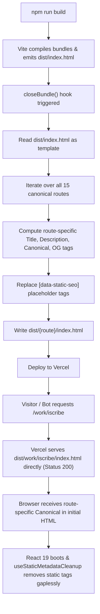

# Implementation Plan: Route-Specific Static Prerendering

**Status:** [Recommendation] & [Verified in code]  
**Architecture:** Vite Build Plugin (`closeBundle` Hook)  
**Dependencies Added:** Zero (Uses native Node.js `fs` and `path`)  
**Deployment Target:** Vercel Static Hosting with SPA fallback  

---

## 1. Technical Strategy & Mechanism

To solve the P0 canonical URL and metadata mismatch without introducing SSR frameworks, we implement a lightweight **Build-Time Route Entrypoint Generator** directly inside `vite.config.ts`.

### How It Works:

---

## 2. Vercel Static File Precedence

Vercel's routing engine follows strict precedence rules:
1. **Direct File Match:** If a requested path matches an existing static asset in the output directory (e.g. `/work/iscribe` matching `dist/work/iscribe/index.html`), Vercel serves that file immediately with HTTP 200 and correct `content-type: text/html`.
2. **Rewrites Fallback:** If and only if no file exists matching the path, Vercel executes the rewrite in `vercel.json` (`/(.*) -> /index.html`).

By outputting physical HTML files for all 15 indexable routes, every crawler, bot, and browser receives an exact, self-referencing canonical URL in the first byte of raw HTML.

---

## 3. Compatibility & Non-Destructive Guarantees

1. **Client-Side SPA Routing Unaffected:** Because each generated `index.html` contains the identical `

` container and script tags, client-side React Router navigation functions exactly as before.
2. **React 19 Tag Hoisting Compatibility:** React 19's `src/components/Seo.tsx` has `useStaticMetadataCleanup()`, which removes any `[data-static-seo]` tags upon component mount. By maintaining `data-static-seo` on prerendered tags, there is zero duplicate tag accumulation.
3. **Rollback Plan:**
   - If prerendering fails during build, the build aborts before emission.
   - If reverting is needed, removing the prerender plugin in `vite.config.ts` immediately restores the default single-file SPA build with zero code side effects.
