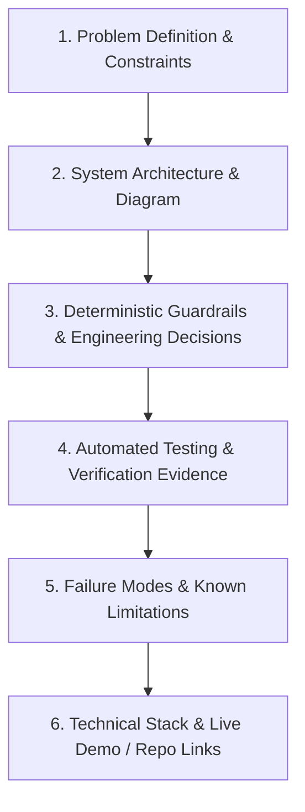

# Evidence-Based Case Study Content Plan

**Focus Projects:** iScribe (Clinical AI Architecture) & PromptToShort (Python Media Pipeline)  
**Target Audience:** Technical Recruiters, Engineering Leads, AI Systems Architects  
**Status:** [Recommendation] & [Verified in code]  

---

## 1. Case Study Architectural Framework

Every case study on `https://akthernaimudheen.in/` must adhere to an engineering-first narrative structure designed to answer recruiter and hiring manager vetting criteria:

---

## 2. iScribe: Clinical Documentation Case Study Plan (`/work/iscribe`)

### Core Narrative Focus
Shift from "AI transcription" to **"Deterministic Verification and Guardrails for Clinical Fact Extraction"**.

### Mandatory Content Sections
1. **The Core Clinical Problem:**
   - In bilingual Indian consultations (Malayalam-English code-switching), off-the-shelf generative models frequently hallucinate non-existent dosages or omit negative symptoms (e.g. converting "no fever" into "fever present").
2. **Deterministic Architecture:**
   - Multi-stage pipeline: Audio Intake -> Whisper Fine-Tuning -> SpaCy Clinical NER -> Pydantic Schema Validation -> Verbatim Span Anchoring.
   - Any clinical fact extracted by the LLM that cannot be matched back to a character span in the transcript is rejected.
3. **Automated Testing Evidence:**
   - Explicitly cite the **1,208 automated tests** in `C:\Projects\iScribe\tests`.
   - Document synthetic test fixtures and zero PHI emission guardrails.
4. **Honest Limitations Disclosure:**
   - Clearly state that iScribe is an **experimental research prototype**, not a CE/FDA approved diagnostic tool.
   - Disclose latency trade-offs: Multi-stage deterministic verification adds ~400ms compared to a single unconstrained LLM call.
5. **Cross-Linking Strategy:**
   - Deep-link directly to `/blog/building-clinical-ai-beyond-transcription` for full mathematical and code breakdowns.

---

## 3. PromptToShort: Python Media Pipeline Case Study Plan (`/work/rshorts`)

### Core Narrative Focus
Demonstrate mastery over **asynchronous backend architecture, FFmpeg video processing, and worker orchestration**.

### Mandatory Content Sections
1. **The System Bottleneck:**
   - Video processing is CPU/GPU intensive and cannot be handled synchronously within an HTTP request cycle without timing out.
2. **Asynchronous Architecture:**
   - FastAPI REST API -> Redis Message Broker -> Celery Background Workers -> FFmpeg Filtergraphs -> AWS S3 / Cloudflare R2 Storage.
   - Dynamic video reframing (16:9 to 9:16) with active speaker face-tracking.
3. **Automated Testing Evidence:**
   - Highlight the **2,448 collected automated tests** across 139 files.
   - Detail the 171 media pipeline tests and 195 scene review tests.
4. **Failure Modes & Rate-Limit Handling:**
   - Explain token bucket rate-limiting for external AI APIs.
   - FFmpeg process isolation to prevent memory leaks during multi-hour render jobs.
5. **Demo Boundaries:**
   - Link to isolated public guest demo (`prompttoshort.online`), clearly identifying guest mode constraints (sample data only, video generation paused, 0 paid API costs).
