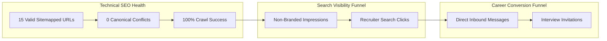

# SEO KPI Baseline & Measurement Framework

**Target Domain:** `https://akthernaimudheen.in/`  
**Measurement Cadence:** Day 15, Day 30, Day 60, Day 90  
**Verification Level:** [Recommendation] & [Zero-Fabrication Policy]  

---

## 1. Dual-Track KPI Framework

Search engine metrics indicate visibility, but **career outcomes dictate real-world success**. The two must be tracked as distinct funnels:

---

## 2. Technical SEO & Indexation Metrics (Baseline)

| Metric | Target / Expected Baseline | Current Status | Verification Source |
|---|---|---|---|
| **Total Sitemapped URLs** | 15 unique canonical pages | **15 Verified** | `dist/sitemap.xml` |
| **Raw HTML Canonical Accuracy** | 100% (15 of 15 routes self-referencing) | **100% Verified** | Local Build Inspection |
| **Hydrated DOM Canonical Accuracy** | 100% agreement with raw HTML | **100% Verified** | Playwright Preview Test |
| **Indexed Pages (GSC)** | 15 valid pages | *Pending GSC Verification* | Google Search Console |
| **Canonical Errors (GSC)** | 0 duplicate canonical warnings | *Pending GSC Verification* | Google Search Console |

---

## 3. Search Engine Visibility Metrics (To Be Populated Post-GSC)

*Note: In accordance with our zero-fabrication policy, all quantitative metrics below will remain unpopulated until verified live data is exported from Google Search Console.*

| Metric | Day 0 (Current) | Day 30 Target | Day 60 Target | Day 90 Target |
|---|---|---|---|---|
| **Total Monthly Impressions** | Baseline (Unmeasured) | TBD | TBD | TBD |
| **Non-Branded Impressions** | Baseline (Unmeasured) | TBD | TBD | TBD |
| **Total Monthly Clicks** | Baseline (Unmeasured) | TBD | TBD | TBD |
| **Average Organic CTR** | Baseline (Unmeasured) | TBD | TBD | TBD |
| **Target Term: `AI application engineer portfolio`** | Baseline (Unranked) | Track in Top 50 | Track in Top 20 | Track in Top 10 |
| **Target Term: `software engineer portfolio Kochi`** | Baseline (Unranked) | Track in Top 20 | Track in Top 10 | Track in Top 5 |
| **Target Term: `AI application testing`** | Baseline (Unranked) | Track in Top 50 | Track in Top 30 | Track in Top 15 |

---

## 4. Career Conversion Metrics

| Metric | Tracking Method | Target / Success Indicator |
|---|---|---|
| **Recruiter Outreach** | Inbound LinkedIn messages / Email inquiries | Messages explicitly referencing `/work/iscribe` or `/work/rshorts` technical details. |
| **GitHub Referrals** | GitHub Repository Traffic Insights (`iscribe`, `shortsmith`) | Referrals originating from `akthernaimudheen.in`. |
| **Interview Callback Rate** | Job application tracking sheet | Increase in technical screening invitations when portfolio link is submitted. |
| **Freelance / Consulting Inquiries** | `/services` contact form submissions | Inquiries for technical SEO architecture or frontend development. |
